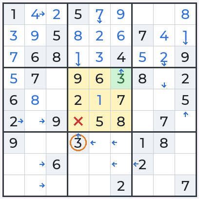

<!-- Written by tools/walkthrough.py search-nine: edit the script, not this page. -->
# Search Nine, step 21: the 3 in box 5

**Step 21 of 51** · [← Step 20](step-20.md) · [All steps](../search-nine.md#the-whole-puzzle-step-by-step) · [Step 22 →](step-22.md)

Box 5 needs a 3. r6c4: column 4 has one (r7c4). Only **r4c6** is left: **r4c6 = 3**.

**Step 21 of 51** · [← Step 20](step-20.md) · [All steps](../search-nine.md#the-whole-puzzle-step-by-step) · [Step 22 →](step-22.md)
