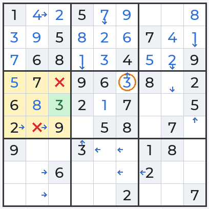

<!-- Written by tools/walkthrough.py search-nine: edit the script, not this page. -->
# Search Nine, step 22: the 3 in box 4

**Step 22 of 51** · [← Step 21](step-21.md) · [All steps](../search-nine.md#the-whole-puzzle-step-by-step) · [Step 23 →](step-23.md)

Box 4 needs a 3. r4c3: row 4 has one (r4c6). r6c2: its arrow points right, and 3 cells that way, r6c5 is 5, not the 9. Only **r5c3** is left: **r5c3 = 3**.

**Step 22 of 51** · [← Step 21](step-21.md) · [All steps](../search-nine.md#the-whole-puzzle-step-by-step) · [Step 23 →](step-23.md)
