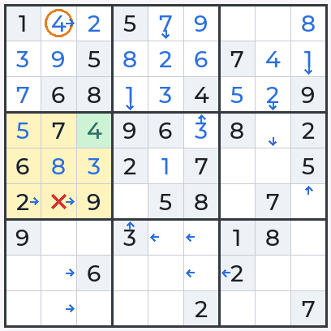

<!-- Written by tools/walkthrough.py search-nine: edit the script, not this page. -->
# Search Nine, step 23: the 4 in box 4

**Step 23 of 51** · [← Step 22](step-22.md) · [All steps](../search-nine.md#the-whole-puzzle-step-by-step) · [Step 24 →](step-24.md)

Box 4 needs a 4. r6c2: column 2 has one (r1c2). Only **r4c3** is left: **r4c3 = 4**.

**Step 23 of 51** · [← Step 22](step-22.md) · [All steps](../search-nine.md#the-whole-puzzle-step-by-step) · [Step 24 →](step-24.md)
