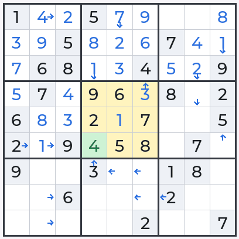

<!-- Written by tools/walkthrough.py search-nine: edit the script, not this page. -->
# Search Nine, step 25: the 4 in box 5

**Step 25 of 51** · [← Step 24](step-24.md) · [All steps](../search-nine.md#the-whole-puzzle-step-by-step) · [Step 26 →](step-26.md)

Box 5 needs a 4, and r6c4 is its last empty cell: **r6c4 = 4**.

**Step 25 of 51** · [← Step 24](step-24.md) · [All steps](../search-nine.md#the-whole-puzzle-step-by-step) · [Step 26 →](step-26.md)
