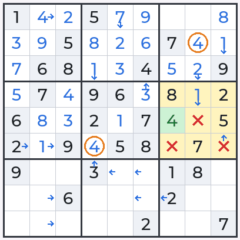

<!-- Written by tools/walkthrough.py search-nine: edit the script, not this page. -->
# Search Nine, step 27: the 4 in box 6

**Step 27 of 51** · [← Step 26](step-26.md) · [All steps](../search-nine.md#the-whole-puzzle-step-by-step) · [Step 28 →](step-28.md)

Box 6 needs a 4. r5c8: column 8 has one (r2c8). r6c7 and r6c9: row 6 has one (r6c4). Only **r5c7** is left: **r5c7 = 4**.

**Step 27 of 51** · [← Step 26](step-26.md) · [All steps](../search-nine.md#the-whole-puzzle-step-by-step) · [Step 28 →](step-28.md)
