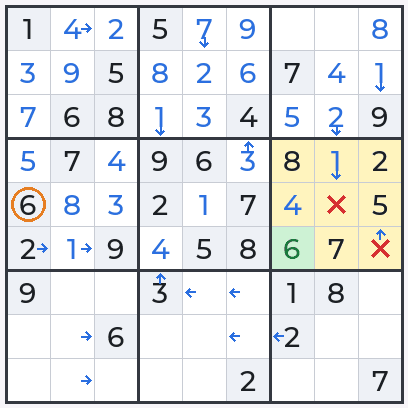

<!-- Written by tools/walkthrough.py search-nine: edit the script, not this page. -->
# Search Nine, step 28: the 6 in box 6

**Step 28 of 51** · [← Step 27](step-27.md) · [All steps](../search-nine.md#the-whole-puzzle-step-by-step) · [Step 29 →](step-29.md)

Box 6 needs a 6. r5c8: row 5 has one (r5c1). r6c9: its arrow points up, and the board ends 5 cells that way, so it's at most 5. Only **r6c7** is left: **r6c7 = 6**.

**Step 28 of 51** · [← Step 27](step-27.md) · [All steps](../search-nine.md#the-whole-puzzle-step-by-step) · [Step 29 →](step-29.md)
