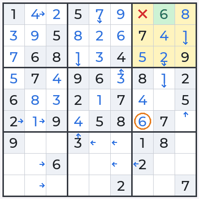

<!-- Written by tools/walkthrough.py search-nine: edit the script, not this page. -->
# Search Nine, step 29: the 6 in box 3

**Step 29 of 51** · [← Step 28](step-28.md) · [All steps](../search-nine.md#the-whole-puzzle-step-by-step) · [Step 30 →](step-30.md)

Box 3 needs a 6. r1c7: column 7 has one (r6c7). Only **r1c8** is left: **r1c8 = 6**.

**Step 29 of 51** · [← Step 28](step-28.md) · [All steps](../search-nine.md#the-whole-puzzle-step-by-step) · [Step 30 →](step-30.md)
