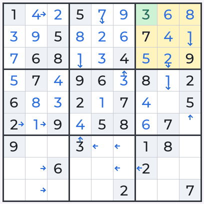

<!-- Written by tools/walkthrough.py search-nine: edit the script, not this page. -->
# Search Nine, step 30: the 3 in box 3

**Step 30 of 51** · [← Step 29](step-29.md) · [All steps](../search-nine.md#the-whole-puzzle-step-by-step) · [Step 31 →](step-31.md)

Box 3 needs a 3, and r1c7 is its last empty cell: **r1c7 = 3**.

**Step 30 of 51** · [← Step 29](step-29.md) · [All steps](../search-nine.md#the-whole-puzzle-step-by-step) · [Step 31 →](step-31.md)
