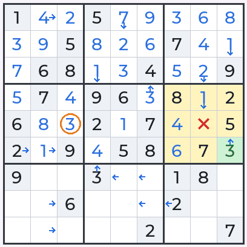

<!-- Written by tools/walkthrough.py search-nine: edit the script, not this page. -->
# Search Nine, step 31: the 3 in box 6

**Step 31 of 51** · [← Step 30](step-30.md) · [All steps](../search-nine.md#the-whole-puzzle-step-by-step) · [Step 32 →](step-32.md)

Box 6 needs a 3. r5c8: row 5 has one (r5c3). Only **r6c9** is left: **r6c9 = 3**.

**Step 31 of 51** · [← Step 30](step-30.md) · [All steps](../search-nine.md#the-whole-puzzle-step-by-step) · [Step 32 →](step-32.md)
