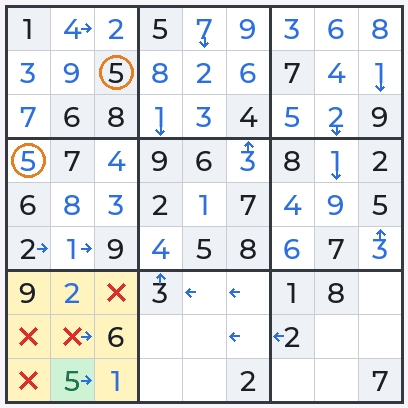

<!-- Written by tools/walkthrough.py search-nine: edit the script, not this page. -->
# Search Nine, step 35: the 5 in box 7

**Step 35 of 51** · [← Step 34](step-34.md) · [All steps](../search-nine.md#the-whole-puzzle-step-by-step) · [Step 36 →](step-36.md)

Box 7 needs a 5. r7c3: column 3 has one (r2c3). r8c1 and r9c1: column 1 has one (r4c1). r8c2: its arrow points right, and 5 cells that way, r8c7 is 2, not the 9. Only **r9c2** is left: **r9c2 = 5**.

**Step 35 of 51** · [← Step 34](step-34.md) · [All steps](../search-nine.md#the-whole-puzzle-step-by-step) · [Step 36 →](step-36.md)
