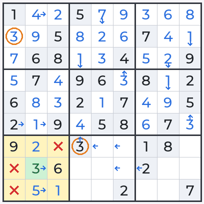

<!-- Written by tools/walkthrough.py search-nine: edit the script, not this page. -->
# Search Nine, step 36: the 3 in box 7

**Step 36 of 51** · [← Step 35](step-35.md) · [All steps](../search-nine.md#the-whole-puzzle-step-by-step) · [Step 37 →](step-37.md)

Box 7 needs a 3. r7c3: row 7 has one (r7c4). r8c1 and r9c1: column 1 has one (r2c1). Only **r8c2** is left: **r8c2 = 3**.

**Step 36 of 51** · [← Step 35](step-35.md) · [All steps](../search-nine.md#the-whole-puzzle-step-by-step) · [Step 37 →](step-37.md)
