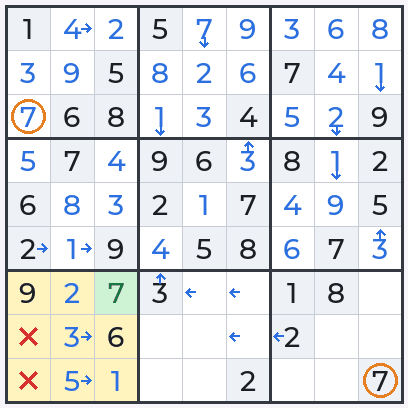

<!-- Written by tools/walkthrough.py search-nine: edit the script, not this page. -->
# Search Nine, step 37: the 7 in box 7

**Step 37 of 51** · [← Step 36](step-36.md) · [All steps](../search-nine.md#the-whole-puzzle-step-by-step) · [Step 38 →](step-38.md)

Box 7 needs a 7. r8c1: column 1 has one (r3c1). r9c1: row 9 has one (r9c9). Only **r7c3** is left: **r7c3 = 7**.

**Step 37 of 51** · [← Step 36](step-36.md) · [All steps](../search-nine.md#the-whole-puzzle-step-by-step) · [Step 38 →](step-38.md)
