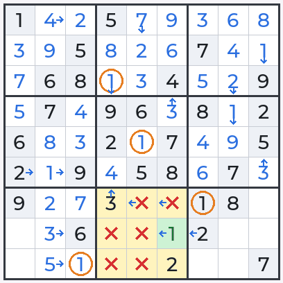

<!-- Written by tools/walkthrough.py search-nine: edit the script, not this page. -->
# Search Nine, step 38: the 1 in box 8

**Step 38 of 51** · [← Step 37](step-37.md) · [All steps](../search-nine.md#the-whole-puzzle-step-by-step) · [Step 39 →](step-39.md)

Box 8 needs a 1. r7c5 and r7c6: row 7 has one (r7c7). r8c4: column 4 has one (r3c4). r8c5: column 5 has one (r5c5). r9c4 and r9c5: row 9 has one (r9c3). Only **r8c6** is left: **r8c6 = 1**.

**Step 38 of 51** · [← Step 37](step-37.md) · [All steps](../search-nine.md#the-whole-puzzle-step-by-step) · [Step 39 →](step-39.md)
