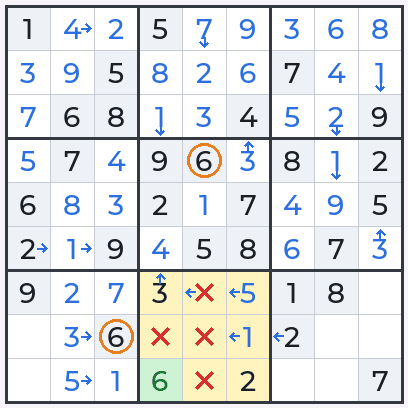

<!-- Written by tools/walkthrough.py search-nine: edit the script, not this page. -->
# Search Nine, step 40: the 6 in box 8

**Step 40 of 51** · [← Step 39](step-39.md) · [All steps](../search-nine.md#the-whole-puzzle-step-by-step) · [Step 41 →](step-41.md)

Box 8 needs a 6. r7c5 and r9c5: column 5 has one (r4c5). r8c4 and r8c5: row 8 has one (r8c3). Only **r9c4** is left: **r9c4 = 6**.

**Step 40 of 51** · [← Step 39](step-39.md) · [All steps](../search-nine.md#the-whole-puzzle-step-by-step) · [Step 41 →](step-41.md)
