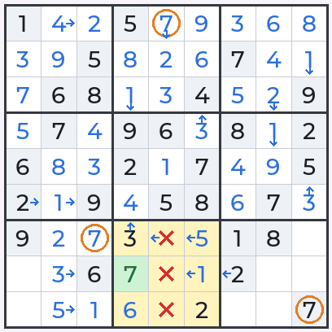

<!-- Written by tools/walkthrough.py search-nine: edit the script, not this page. -->
# Search Nine, step 41: the 7 in box 8

**Step 41 of 51** · [← Step 40](step-40.md) · [All steps](../search-nine.md#the-whole-puzzle-step-by-step) · [Step 42 →](step-42.md)

Box 8 needs a 7. r7c5: row 7 has one (r7c3). r8c5: column 5 has one (r1c5). r9c5: row 9 has one (r9c9). Only **r8c4** is left: **r8c4 = 7**.

**Step 41 of 51** · [← Step 40](step-40.md) · [All steps](../search-nine.md#the-whole-puzzle-step-by-step) · [Step 42 →](step-42.md)
