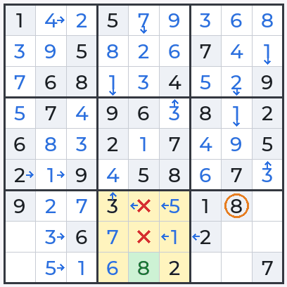

<!-- Written by tools/walkthrough.py search-nine: edit the script, not this page. -->
# Search Nine, step 42: the 8 in box 8

**Step 42 of 51** · [← Step 41](step-41.md) · [All steps](../search-nine.md#the-whole-puzzle-step-by-step) · [Step 43 →](step-43.md)

Box 8 needs an 8. r7c5: row 7 has one (r7c8). r8c5: the 7 in r1c5 points down at it, 7 cells away: it's the 9. Only **r9c5** is left: **r9c5 = 8**.

**Step 42 of 51** · [← Step 41](step-41.md) · [All steps](../search-nine.md#the-whole-puzzle-step-by-step) · [Step 43 →](step-43.md)
