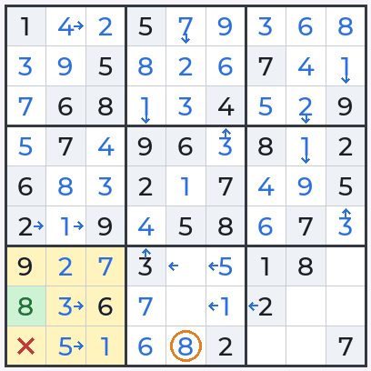

<!-- Written by tools/walkthrough.py search-nine: edit the script, not this page. -->
# Search Nine, step 43: the 8 in box 7

**Step 43 of 51** · [← Step 42](step-42.md) · [All steps](../search-nine.md#the-whole-puzzle-step-by-step) · [Step 44 →](step-44.md)

Box 7 needs an 8. r9c1: row 9 has one (r9c5). Only **r8c1** is left: **r8c1 = 8**.

**Step 43 of 51** · [← Step 42](step-42.md) · [All steps](../search-nine.md#the-whole-puzzle-step-by-step) · [Step 44 →](step-44.md)
