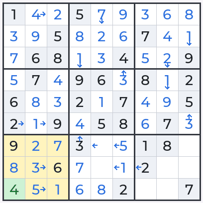

<!-- Written by tools/walkthrough.py search-nine: edit the script, not this page. -->
# Search Nine, step 44: the 4 in box 7

**Step 44 of 51** · [← Step 43](step-43.md) · [All steps](../search-nine.md#the-whole-puzzle-step-by-step) · [Step 45 →](step-45.md)

Box 7 needs a 4, and r9c1 is its last empty cell: **r9c1 = 4**.

**Step 44 of 51** · [← Step 43](step-43.md) · [All steps](../search-nine.md#the-whole-puzzle-step-by-step) · [Step 45 →](step-45.md)
