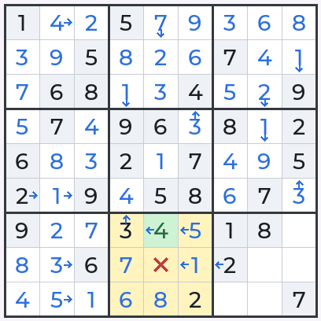

<!-- Written by tools/walkthrough.py search-nine: edit the script, not this page. -->
# Search Nine, step 45: the 4 in box 8

**Step 45 of 51** · [← Step 44](step-44.md) · [All steps](../search-nine.md#the-whole-puzzle-step-by-step) · [Step 46 →](step-46.md)

Box 8 needs a 4. r8c5: the 7 in r1c5 points down at it, 7 cells away: it's the 9. Only **r7c5** is left: **r7c5 = 4**.

**Step 45 of 51** · [← Step 44](step-44.md) · [All steps](../search-nine.md#the-whole-puzzle-step-by-step) · [Step 46 →](step-46.md)
