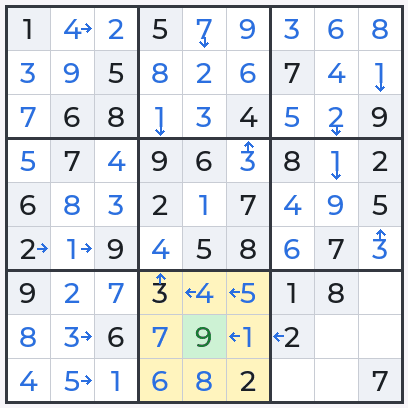

<!-- Written by tools/walkthrough.py search-nine: edit the script, not this page. -->
# Search Nine, step 46: the 9 in box 8

**Step 46 of 51** · [← Step 45](step-45.md) · [All steps](../search-nine.md#the-whole-puzzle-step-by-step) · [Step 47 →](step-47.md)

Box 8 needs a 9, and r8c5 is its last empty cell: **r8c5 = 9**.

**Step 46 of 51** · [← Step 45](step-45.md) · [All steps](../search-nine.md#the-whole-puzzle-step-by-step) · [Step 47 →](step-47.md)
