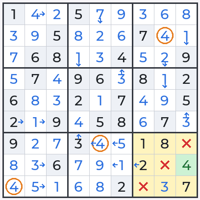

<!-- Written by tools/walkthrough.py search-nine: edit the script, not this page. -->
# Search Nine, step 48: the 4 in box 9

**Step 48 of 51** · [← Step 47](step-47.md) · [All steps](../search-nine.md#the-whole-puzzle-step-by-step) · [Step 49 →](step-49.md)

Box 9 needs a 4. r7c9: row 7 has one (r7c5). r8c8: column 8 has one (r2c8). r9c7: row 9 has one (r9c1). Only **r8c9** is left: **r8c9 = 4**.

**Step 48 of 51** · [← Step 47](step-47.md) · [All steps](../search-nine.md#the-whole-puzzle-step-by-step) · [Step 49 →](step-49.md)
