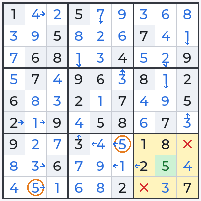

<!-- Written by tools/walkthrough.py search-nine: edit the script, not this page. -->
# Search Nine, step 49: the 5 in box 9

**Step 49 of 51** · [← Step 48](step-48.md) · [All steps](../search-nine.md#the-whole-puzzle-step-by-step) · [Step 50 →](step-50.md)

Box 9 needs a 5. r7c9: row 7 has one (r7c6). r9c7: row 9 has one (r9c2). Only **r8c8** is left: **r8c8 = 5**.

**Step 49 of 51** · [← Step 48](step-48.md) · [All steps](../search-nine.md#the-whole-puzzle-step-by-step) · [Step 50 →](step-50.md)
