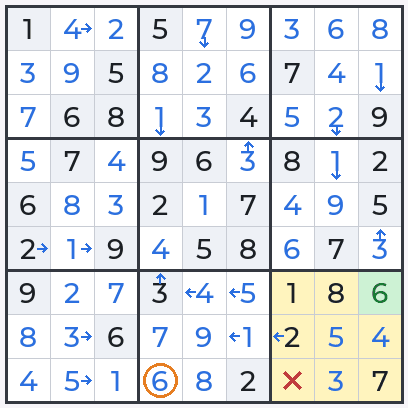

<!-- Written by tools/walkthrough.py search-nine: edit the script, not this page. -->
# Search Nine, step 50: the 6 in box 9

**Step 50 of 51** · [← Step 49](step-49.md) · [All steps](../search-nine.md#the-whole-puzzle-step-by-step) · [Step 51 →](step-51.md)

Box 9 needs a 6. r9c7: row 9 has one (r9c4). Only **r7c9** is left: **r7c9 = 6**.

**Step 50 of 51** · [← Step 49](step-49.md) · [All steps](../search-nine.md#the-whole-puzzle-step-by-step) · [Step 51 →](step-51.md)
