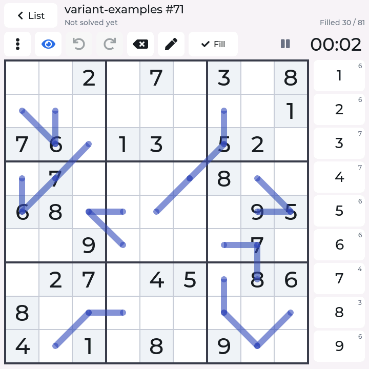
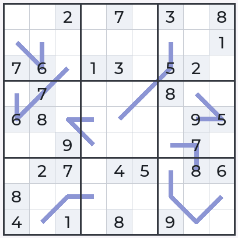

# Sequence Lines

[← All variants](README.md) · [Puzzles](../features-puzzles.md) · [How to play](../how-to-play.md)

## The rules

[Classic](classic.md) rules, and **indigo lines**: along a line, the digits go **up or down by the same step** from cell to cell, 1 or more: 2 4 6 8, or 9 6 3, or 4 5 6. So no digit repeats on a line, and the line reads the same either way round (just counting down instead of up).

## On the board

- The lines are drawn in indigo, a little wider than the Whispers lines.
- Two digits on a line that no single step can join, or a digit off the step the others set, turn the line's digits red.
- The grader and hints know one step: each cell on a line keeps only the digits some step and start allow, given what the line's other cells can still be ("Along this line the digits go up or down by the same step, cell to cell: that leaves row 3, column 3 only 8").
- **Puzzles → ⋮ → New puzzle → Lines → Sequence**: 8 lines of 3 to 5 cells (Hard and Expert: 10).

## How to solve it

- **Two digits fix the line.** With two digits on a line, the step is their difference over how far apart they are, and every other cell follows.
- **Long lines, small steps.** A line of 5 cells has a step of 1 or 2 (9 − 1 = 8 at most over 4 steps): its middle cell is never 1 or 9, and its ends never 5.
- **The middle of three.** On a line of three, the middle digit is the average of the ends: 3 _ 7 makes it 5, and an odd and an even end can't share a line of three.
- **Whole steps only.** 2 and 7 three cells apart don't fit (5 over 3 steps): one of them is wrong.

## Worked example

**variant-examples #71**, Sequence Lines Easy (see [Classic](classic.md#worked-example-the-whole-puzzle) for how to import the examples; cells are written r*row*c*column*).

**Step 1: r3c3.** One line runs r4c1, r5c1 (6), r4c2 (7), r3c3. The 6 and the 7 are side by side on it: a step of 1, so the line reads 5 6 7 8. By the Classic rules r3c3 could be 4 or 8 (row 3 has 7, 6, 1, 3, 5 and 2; column 3 has 2, 9, 7 and 1). **r3c3 = 8**.

**Step 2: r4c1.** The same line's first cell: one step below the 6. **r4c1 = 5**.

**Step 3: r5c5.** Another line runs r2c7, r3c7 (5), r4c6, r5c5. By the Classic rules r5c5 could be 1 or 2. A 2 there would be 3 below the 5 over two steps: no whole step. A 1 makes a step of 2 down: 7 5 3 1. **r5c5 = 1**, and with it r4c6 = 3 and r2c7 = 7.

## The whole puzzle, step by step

<!-- walkthrough -->
<!-- Written by tools/walkthrough.py sequence-lines: edit the script, not this part. -->

The whole puzzle, from the start to the last cell: 51 steps, each one a single (one place left for a digit, or one digit left for a cell), taken in the order a box's single comes first, so not quite the order of the worked example above. Each step has a page of its own, with **Previous** and **Next**: pick its number below. In each picture, the unit the step looks at is tinted yellow (for a cell with one digit left: its row, column and box), the new digit is on green, the digits that rule cells out have an **orange ring**, and the empty cells they rule out a **red cross**. Givens are on grey, digits from earlier steps in blue.

| [1](sequence-lines/step-01.md) | [2](sequence-lines/step-02.md) | [3](sequence-lines/step-03.md) | [4](sequence-lines/step-04.md) | [5](sequence-lines/step-05.md) | [6](sequence-lines/step-06.md) | [7](sequence-lines/step-07.md) | [8](sequence-lines/step-08.md) | [9](sequence-lines/step-09.md) | [10](sequence-lines/step-10.md) |
|:-:|:-:|:-:|:-:|:-:|:-:|:-:|:-:|:-:|:-:|
| [11](sequence-lines/step-11.md) | [12](sequence-lines/step-12.md) | [13](sequence-lines/step-13.md) | [14](sequence-lines/step-14.md) | [15](sequence-lines/step-15.md) | [16](sequence-lines/step-16.md) | [17](sequence-lines/step-17.md) | [18](sequence-lines/step-18.md) | [19](sequence-lines/step-19.md) | [20](sequence-lines/step-20.md) |
| [21](sequence-lines/step-21.md) | [22](sequence-lines/step-22.md) | [23](sequence-lines/step-23.md) | [24](sequence-lines/step-24.md) | [25](sequence-lines/step-25.md) | [26](sequence-lines/step-26.md) | [27](sequence-lines/step-27.md) | [28](sequence-lines/step-28.md) | [29](sequence-lines/step-29.md) | [30](sequence-lines/step-30.md) |
| [31](sequence-lines/step-31.md) | [32](sequence-lines/step-32.md) | [33](sequence-lines/step-33.md) | [34](sequence-lines/step-34.md) | [35](sequence-lines/step-35.md) | [36](sequence-lines/step-36.md) | [37](sequence-lines/step-37.md) | [38](sequence-lines/step-38.md) | [39](sequence-lines/step-39.md) | [40](sequence-lines/step-40.md) |
| [41](sequence-lines/step-41.md) | [42](sequence-lines/step-42.md) | [43](sequence-lines/step-43.md) | [44](sequence-lines/step-44.md) | [45](sequence-lines/step-45.md) | [46](sequence-lines/step-46.md) | [47](sequence-lines/step-47.md) | [48](sequence-lines/step-48.md) | [49](sequence-lines/step-49.md) | [50](sequence-lines/step-50.md) |
| [51](sequence-lines/step-51.md) |  |  |  |  |  |  |  |  |  |

Solved.

<!-- /walkthrough -->
