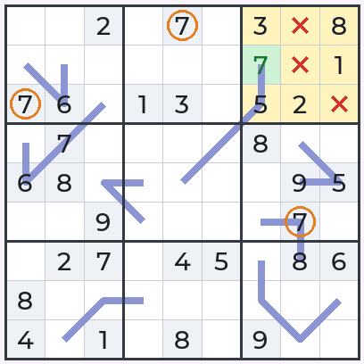

<!-- Written by tools/walkthrough.py sequence-lines: edit the script, not this page. -->
# Sequence Lines, step 1: the 7 in box 3

**Step 1 of 51** · [← The start](../sequence-lines.md#the-whole-puzzle-step-by-step) · [All steps](../sequence-lines.md#the-whole-puzzle-step-by-step) · [Step 2 →](step-02.md)

Box 3 needs a 7. r1c8: row 1 has one (r1c5). r2c8: column 8 has one (r6c8). r3c9: row 3 has one (r3c1). Only **r2c7** is left: **r2c7 = 7**.

**Step 1 of 51** · [← The start](../sequence-lines.md#the-whole-puzzle-step-by-step) · [All steps](../sequence-lines.md#the-whole-puzzle-step-by-step) · [Step 2 →](step-02.md)
