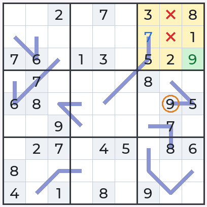

<!-- Written by tools/walkthrough.py sequence-lines: edit the script, not this page. -->
# Sequence Lines, step 2: the 9 in box 3

**Step 2 of 51** · [← Step 1](step-01.md) · [All steps](../sequence-lines.md#the-whole-puzzle-step-by-step) · [Step 3 →](step-03.md)

Box 3 needs a 9. r1c8 and r2c8: column 8 has one (r5c8). Only **r3c9** is left: **r3c9 = 9**.

**Step 2 of 51** · [← Step 1](step-01.md) · [All steps](../sequence-lines.md#the-whole-puzzle-step-by-step) · [Step 3 →](step-03.md)
