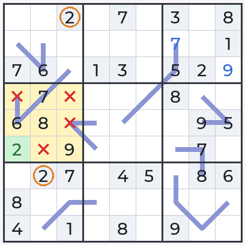

<!-- Written by tools/walkthrough.py sequence-lines: edit the script, not this page. -->
# Sequence Lines, step 3: the 2 in box 4

**Step 3 of 51** · [← Step 2](step-02.md) · [All steps](../sequence-lines.md#the-whole-puzzle-step-by-step) · [Step 4 →](step-04.md)

Box 4 needs a 2. r4c3 and r5c3: column 3 has one (r1c3). r6c2: column 2 has one (r7c2). r4c1: the 6 in r5c1 and the 7 in r4c2 on its indigo line make a step of 1, so it's 5. Only **r6c1** is left: **r6c1 = 2**.

**Step 3 of 51** · [← Step 2](step-02.md) · [All steps](../sequence-lines.md#the-whole-puzzle-step-by-step) · [Step 4 →](step-04.md)
