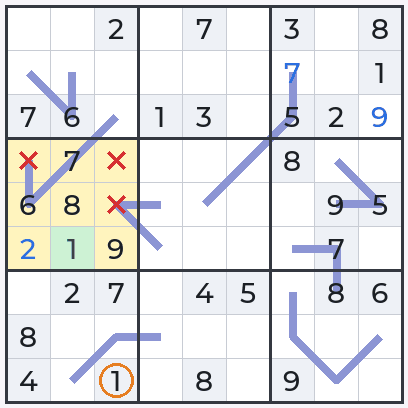

<!-- Written by tools/walkthrough.py sequence-lines: edit the script, not this page. -->
# Sequence Lines, step 4: the 1 in box 4

**Step 4 of 51** · [← Step 3](step-03.md) · [All steps](../sequence-lines.md#the-whole-puzzle-step-by-step) · [Step 5 →](step-05.md)

Box 4 needs a 1. r4c3 and r5c3: column 3 has one (r9c3). r4c1: the 6 in r5c1 and the 7 in r4c2 on its indigo line make a step of 1, so it's 5. Only **r6c2** is left: **r6c2 = 1**.

**Step 4 of 51** · [← Step 3](step-03.md) · [All steps](../sequence-lines.md#the-whole-puzzle-step-by-step) · [Step 5 →](step-05.md)
