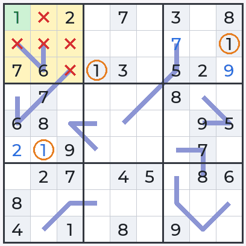

<!-- Written by tools/walkthrough.py sequence-lines: edit the script, not this page. -->
# Sequence Lines, step 5: the 1 in box 1

**Step 5 of 51** · [← Step 4](step-04.md) · [All steps](../sequence-lines.md#the-whole-puzzle-step-by-step) · [Step 6 →](step-06.md)

Box 1 needs a 1. r1c2: column 2 has one (r6c2). r2c1, r2c2 and r2c3: row 2 has one (r2c9). r3c3: row 3 has one (r3c4). Only **r1c1** is left: **r1c1 = 1**.

**Step 5 of 51** · [← Step 4](step-04.md) · [All steps](../sequence-lines.md#the-whole-puzzle-step-by-step) · [Step 6 →](step-06.md)
