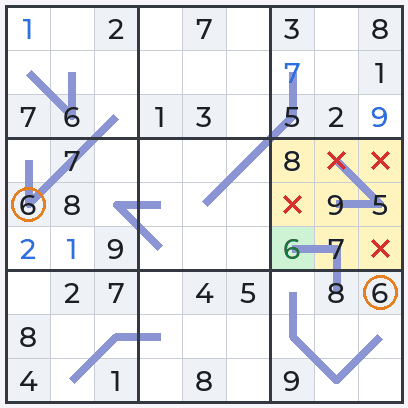

<!-- Written by tools/walkthrough.py sequence-lines: edit the script, not this page. -->
# Sequence Lines, step 6: the 6 in box 6

**Step 6 of 51** · [← Step 5](step-05.md) · [All steps](../sequence-lines.md#the-whole-puzzle-step-by-step) · [Step 7 →](step-07.md)

Box 6 needs a 6. r4c9 and r6c9: column 9 has one (r7c9). r5c7: row 5 has one (r5c1). r4c8: the 5 in r5c9 and the 9 in r5c8 on its indigo line make a step of 4, so it's 1. Only **r6c7** is left: **r6c7 = 6**.

**Step 6 of 51** · [← Step 5](step-05.md) · [All steps](../sequence-lines.md#the-whole-puzzle-step-by-step) · [Step 7 →](step-07.md)
