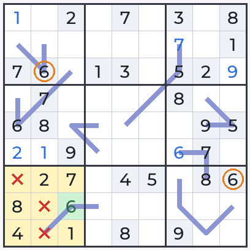

<!-- Written by tools/walkthrough.py sequence-lines: edit the script, not this page. -->
# Sequence Lines, step 7: the 6 in box 7

**Step 7 of 51** · [← Step 6](step-06.md) · [All steps](../sequence-lines.md#the-whole-puzzle-step-by-step) · [Step 8 →](step-08.md)

Box 7 needs a 6. r7c1: row 7 has one (r7c9). r8c2 and r9c2: column 2 has one (r3c2). Only **r8c3** is left: **r8c3 = 6**.

**Step 7 of 51** · [← Step 6](step-06.md) · [All steps](../sequence-lines.md#the-whole-puzzle-step-by-step) · [Step 8 →](step-08.md)
