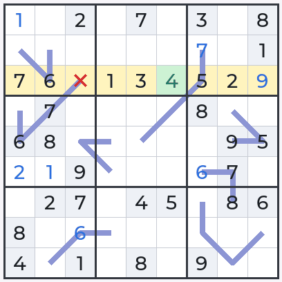

<!-- Written by tools/walkthrough.py sequence-lines: edit the script, not this page. -->
# Sequence Lines, step 8: the 4 in row 3

**Step 8 of 51** · [← Step 7](step-07.md) · [All steps](../sequence-lines.md#the-whole-puzzle-step-by-step) · [Step 9 →](step-09.md)

Row 3 needs a 4. r3c3: the 6 in r5c1 and the 7 in r4c2 on its indigo line make a step of 1, so it's 8. Only **r3c6** is left: **r3c6 = 4**.

**Step 8 of 51** · [← Step 7](step-07.md) · [All steps](../sequence-lines.md#the-whole-puzzle-step-by-step) · [Step 9 →](step-09.md)
