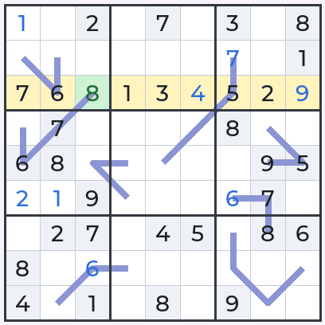

<!-- Written by tools/walkthrough.py sequence-lines: edit the script, not this page. -->
# Sequence Lines, step 9: the 8 in row 3

**Step 9 of 51** · [← Step 8](step-08.md) · [All steps](../sequence-lines.md#the-whole-puzzle-step-by-step) · [Step 10 →](step-10.md)

Row 3 needs an 8, and r3c3 is its last empty cell: **r3c3 = 8**.

**Step 9 of 51** · [← Step 8](step-08.md) · [All steps](../sequence-lines.md#the-whole-puzzle-step-by-step) · [Step 10 →](step-10.md)
