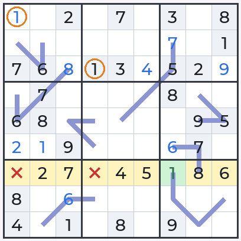

<!-- Written by tools/walkthrough.py sequence-lines: edit the script, not this page. -->
# Sequence Lines, step 10: the 1 in row 7

**Step 10 of 51** · [← Step 9](step-09.md) · [All steps](../sequence-lines.md#the-whole-puzzle-step-by-step) · [Step 11 →](step-11.md)

Row 7 needs a 1. r7c1: column 1 has one (r1c1). r7c4: column 4 has one (r3c4). Only **r7c7** is left: **r7c7 = 1**.

**Step 10 of 51** · [← Step 9](step-09.md) · [All steps](../sequence-lines.md#the-whole-puzzle-step-by-step) · [Step 11 →](step-11.md)
