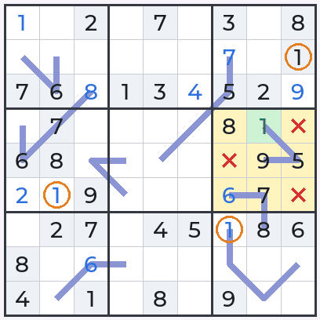

<!-- Written by tools/walkthrough.py sequence-lines: edit the script, not this page. -->
# Sequence Lines, step 11: the 1 in box 6

**Step 11 of 51** · [← Step 10](step-10.md) · [All steps](../sequence-lines.md#the-whole-puzzle-step-by-step) · [Step 12 →](step-12.md)

Box 6 needs a 1. r4c9: column 9 has one (r2c9). r5c7: column 7 has one (r7c7). r6c9: row 6 has one (r6c2). Only **r4c8** is left: **r4c8 = 1**.

**Step 11 of 51** · [← Step 10](step-10.md) · [All steps](../sequence-lines.md#the-whole-puzzle-step-by-step) · [Step 12 →](step-12.md)
