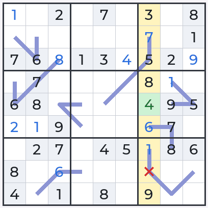

<!-- Written by tools/walkthrough.py sequence-lines: edit the script, not this page. -->
# Sequence Lines, step 12: the 4 in column 7

**Step 12 of 51** · [← Step 11](step-11.md) · [All steps](../sequence-lines.md#the-whole-puzzle-step-by-step) · [Step 13 →](step-13.md)

Column 7 needs a 4. r8c7: with the 1 in r7c7 on its indigo line, a 4 here makes a step of 3, which runs out of 1-9 along the line. Only **r5c7** is left: **r5c7 = 4**.

**Step 12 of 51** · [← Step 11](step-11.md) · [All steps](../sequence-lines.md#the-whole-puzzle-step-by-step) · [Step 13 →](step-13.md)
