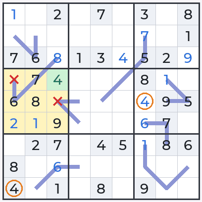

<!-- Written by tools/walkthrough.py sequence-lines: edit the script, not this page. -->
# Sequence Lines, step 13: the 4 in box 4

**Step 13 of 51** · [← Step 12](step-12.md) · [All steps](../sequence-lines.md#the-whole-puzzle-step-by-step) · [Step 14 →](step-14.md)

Box 4 needs a 4. r4c1: column 1 has one (r9c1). r5c3: row 5 has one (r5c7). Only **r4c3** is left: **r4c3 = 4**.

**Step 13 of 51** · [← Step 12](step-12.md) · [All steps](../sequence-lines.md#the-whole-puzzle-step-by-step) · [Step 14 →](step-14.md)
