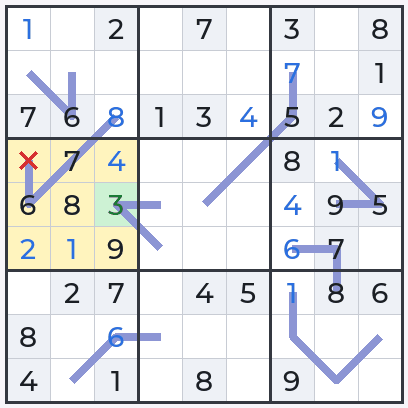

<!-- Written by tools/walkthrough.py sequence-lines: edit the script, not this page. -->
# Sequence Lines, step 14: the 3 in box 4

**Step 14 of 51** · [← Step 13](step-13.md) · [All steps](../sequence-lines.md#the-whole-puzzle-step-by-step) · [Step 15 →](step-15.md)

Box 4 needs a 3. r4c1: the 6 in r5c1 and the 7 in r4c2 on its indigo line make a step of 1, so it's 5. Only **r5c3** is left: **r5c3 = 3**.

**Step 14 of 51** · [← Step 13](step-13.md) · [All steps](../sequence-lines.md#the-whole-puzzle-step-by-step) · [Step 15 →](step-15.md)
