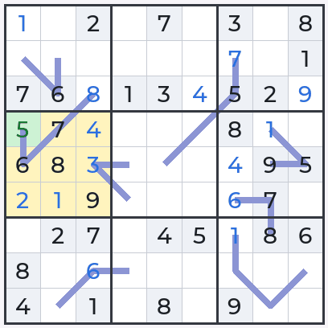

<!-- Written by tools/walkthrough.py sequence-lines: edit the script, not this page. -->
# Sequence Lines, step 15: the 5 in box 4

**Step 15 of 51** · [← Step 14](step-14.md) · [All steps](../sequence-lines.md#the-whole-puzzle-step-by-step) · [Step 16 →](step-16.md)

Box 4 needs a 5, and r4c1 is its last empty cell: **r4c1 = 5**.

**Step 15 of 51** · [← Step 14](step-14.md) · [All steps](../sequence-lines.md#the-whole-puzzle-step-by-step) · [Step 16 →](step-16.md)
