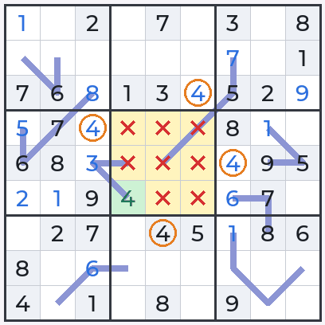

<!-- Written by tools/walkthrough.py sequence-lines: edit the script, not this page. -->
# Sequence Lines, step 16: the 4 in box 5

**Step 16 of 51** · [← Step 15](step-15.md) · [All steps](../sequence-lines.md#the-whole-puzzle-step-by-step) · [Step 17 →](step-17.md)

Box 5 needs a 4. r4c4, r4c5 and r4c6: row 4 has one (r4c3). r5c4, r5c5 and r5c6: row 5 has one (r5c7). r6c5: column 5 has one (r7c5). r6c6: column 6 has one (r3c6). Only **r6c4** is left: **r6c4 = 4**.

**Step 16 of 51** · [← Step 15](step-15.md) · [All steps](../sequence-lines.md#the-whole-puzzle-step-by-step) · [Step 17 →](step-17.md)
