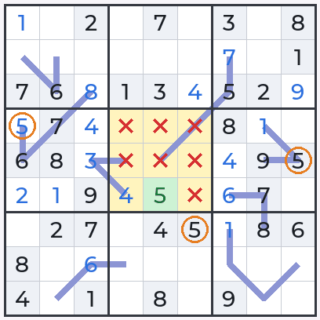

<!-- Written by tools/walkthrough.py sequence-lines: edit the script, not this page. -->
# Sequence Lines, step 17: the 5 in box 5

**Step 17 of 51** · [← Step 16](step-16.md) · [All steps](../sequence-lines.md#the-whole-puzzle-step-by-step) · [Step 18 →](step-18.md)

Box 5 needs a 5. r4c4, r4c5 and r4c6: row 4 has one (r4c1). r5c4, r5c5 and r5c6: row 5 has one (r5c9). r6c6: column 6 has one (r7c6). Only **r6c5** is left: **r6c5 = 5**.

**Step 17 of 51** · [← Step 16](step-16.md) · [All steps](../sequence-lines.md#the-whole-puzzle-step-by-step) · [Step 18 →](step-18.md)
