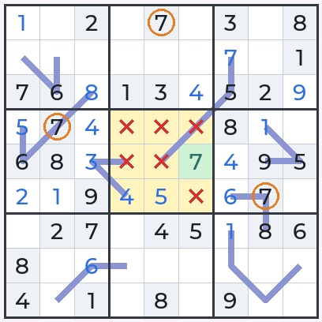

<!-- Written by tools/walkthrough.py sequence-lines: edit the script, not this page. -->
# Sequence Lines, step 18: the 7 in box 5

**Step 18 of 51** · [← Step 17](step-17.md) · [All steps](../sequence-lines.md#the-whole-puzzle-step-by-step) · [Step 19 →](step-19.md)

Box 5 needs a 7. r4c4, r4c5 and r4c6: row 4 has one (r4c2). r5c5: column 5 has one (r1c5). r6c6: row 6 has one (r6c8). r5c4: the 4 in r6c4 and the 3 in r5c3 on its indigo line make a step of -1, so it's 2. Only **r5c6** is left: **r5c6 = 7**.

**Step 18 of 51** · [← Step 17](step-17.md) · [All steps](../sequence-lines.md#the-whole-puzzle-step-by-step) · [Step 19 →](step-19.md)
