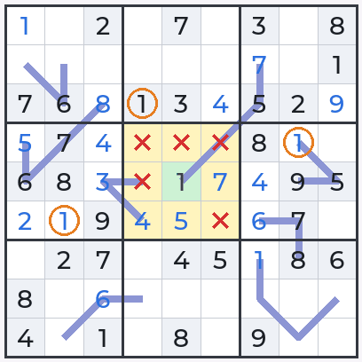

<!-- Written by tools/walkthrough.py sequence-lines: edit the script, not this page. -->
# Sequence Lines, step 19: the 1 in box 5

**Step 19 of 51** · [← Step 18](step-18.md) · [All steps](../sequence-lines.md#the-whole-puzzle-step-by-step) · [Step 20 →](step-20.md)

Box 5 needs a 1. r4c4, r4c5 and r4c6: row 4 has one (r4c8). r5c4: column 4 has one (r3c4). r6c6: row 6 has one (r6c2). Only **r5c5** is left: **r5c5 = 1**.

**Step 19 of 51** · [← Step 18](step-18.md) · [All steps](../sequence-lines.md#the-whole-puzzle-step-by-step) · [Step 20 →](step-20.md)
