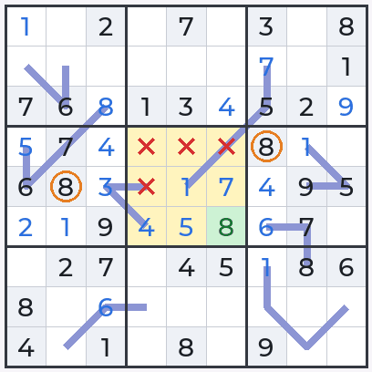

<!-- Written by tools/walkthrough.py sequence-lines: edit the script, not this page. -->
# Sequence Lines, step 20: the 8 in box 5

**Step 20 of 51** · [← Step 19](step-19.md) · [All steps](../sequence-lines.md#the-whole-puzzle-step-by-step) · [Step 21 →](step-21.md)

Box 5 needs an 8. r4c4, r4c5 and r4c6: row 4 has one (r4c7). r5c4: row 5 has one (r5c2). Only **r6c6** is left: **r6c6 = 8**.

**Step 20 of 51** · [← Step 19](step-19.md) · [All steps](../sequence-lines.md#the-whole-puzzle-step-by-step) · [Step 21 →](step-21.md)
