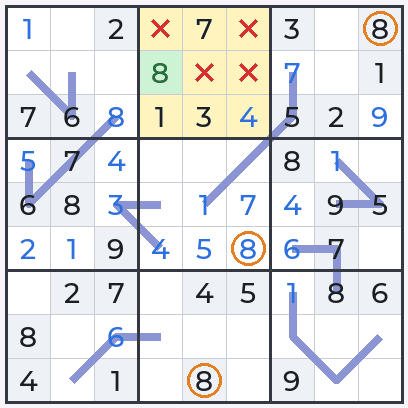

<!-- Written by tools/walkthrough.py sequence-lines: edit the script, not this page. -->
# Sequence Lines, step 21: the 8 in box 2

**Step 21 of 51** · [← Step 20](step-20.md) · [All steps](../sequence-lines.md#the-whole-puzzle-step-by-step) · [Step 22 →](step-22.md)

Box 2 needs an 8. r1c4 and r1c6: row 1 has one (r1c9). r2c5: column 5 has one (r9c5). r2c6: column 6 has one (r6c6). Only **r2c4** is left: **r2c4 = 8**.

**Step 21 of 51** · [← Step 20](step-20.md) · [All steps](../sequence-lines.md#the-whole-puzzle-step-by-step) · [Step 22 →](step-22.md)
