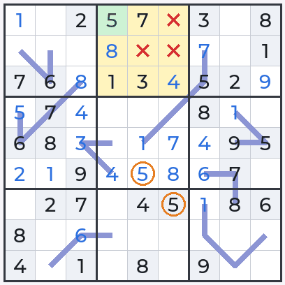

<!-- Written by tools/walkthrough.py sequence-lines: edit the script, not this page. -->
# Sequence Lines, step 22: the 5 in box 2

**Step 22 of 51** · [← Step 21](step-21.md) · [All steps](../sequence-lines.md#the-whole-puzzle-step-by-step) · [Step 23 →](step-23.md)

Box 2 needs a 5. r1c6 and r2c6: column 6 has one (r7c6). r2c5: column 5 has one (r6c5). Only **r1c4** is left: **r1c4 = 5**.

**Step 22 of 51** · [← Step 21](step-21.md) · [All steps](../sequence-lines.md#the-whole-puzzle-step-by-step) · [Step 23 →](step-23.md)
