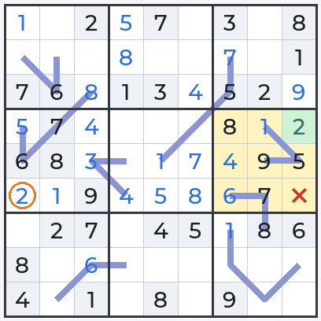

<!-- Written by tools/walkthrough.py sequence-lines: edit the script, not this page. -->
# Sequence Lines, step 23: the 2 in box 6

**Step 23 of 51** · [← Step 22](step-22.md) · [All steps](../sequence-lines.md#the-whole-puzzle-step-by-step) · [Step 24 →](step-24.md)

Box 6 needs a 2. r6c9: row 6 has one (r6c1). Only **r4c9** is left: **r4c9 = 2**.

**Step 23 of 51** · [← Step 22](step-22.md) · [All steps](../sequence-lines.md#the-whole-puzzle-step-by-step) · [Step 24 →](step-24.md)
