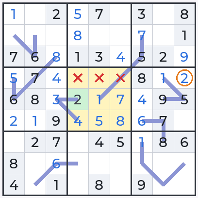

<!-- Written by tools/walkthrough.py sequence-lines: edit the script, not this page. -->
# Sequence Lines, step 24: the 2 in box 5

**Step 24 of 51** · [← Step 23](step-23.md) · [All steps](../sequence-lines.md#the-whole-puzzle-step-by-step) · [Step 25 →](step-25.md)

Box 5 needs a 2. r4c4, r4c5 and r4c6: row 4 has one (r4c9). Only **r5c4** is left: **r5c4 = 2**.

**Step 24 of 51** · [← Step 23](step-23.md) · [All steps](../sequence-lines.md#the-whole-puzzle-step-by-step) · [Step 25 →](step-25.md)
