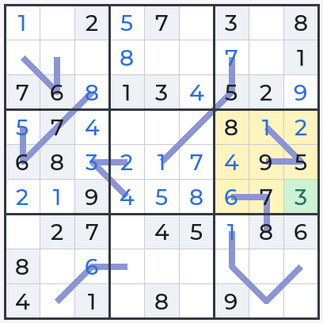

<!-- Written by tools/walkthrough.py sequence-lines: edit the script, not this page. -->
# Sequence Lines, step 25: the 3 in box 6

**Step 25 of 51** · [← Step 24](step-24.md) · [All steps](../sequence-lines.md#the-whole-puzzle-step-by-step) · [Step 26 →](step-26.md)

Box 6 needs a 3, and r6c9 is its last empty cell: **r6c9 = 3**.

**Step 25 of 51** · [← Step 24](step-24.md) · [All steps](../sequence-lines.md#the-whole-puzzle-step-by-step) · [Step 26 →](step-26.md)
