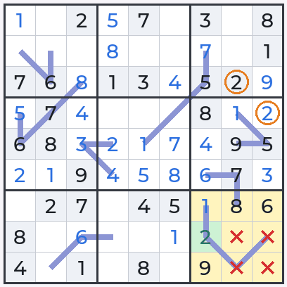

<!-- Written by tools/walkthrough.py sequence-lines: edit the script, not this page. -->
# Sequence Lines, step 27: the 2 in box 9

**Step 27 of 51** · [← Step 26](step-26.md) · [All steps](../sequence-lines.md#the-whole-puzzle-step-by-step) · [Step 28 →](step-28.md)

Box 9 needs a 2. r8c8 and r9c8: column 8 has one (r3c8). r8c9 and r9c9: column 9 has one (r4c9). Only **r8c7** is left: **r8c7 = 2**.

**Step 27 of 51** · [← Step 26](step-26.md) · [All steps](../sequence-lines.md#the-whole-puzzle-step-by-step) · [Step 28 →](step-28.md)
